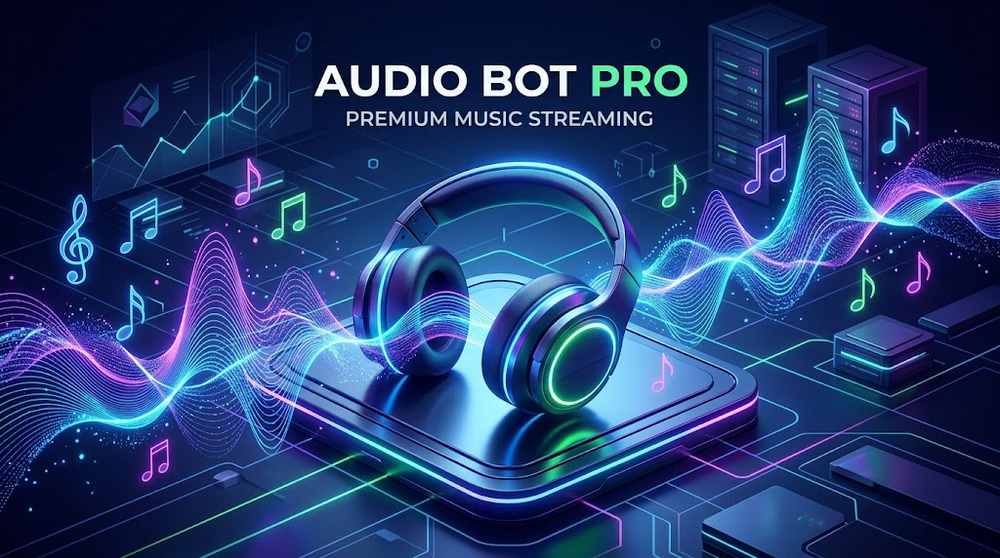

# 🎵 Audio Bot Pro - Discord Music Engine

🌍 **Language / اللغة:** [English](#english-version) | [العربية](#النسخة-العربية)

---

## <a id="english-version"></a> 🇬🇧 English Version

A professional Discord music bot equipped with a Python-based Graphical User Interface (GUI) dashboard. The bot features a persistent, static player inside Discord servers with interactive control buttons, completely eliminating the need for annoying chat commands while keeping your server clean with auto-deleting messages.

### ✨ Features
* **GUI Dashboard:** A professional user interface built with `CustomTkinter` to manage the bot (Token input, Start/Stop controls, Ping monitoring, and Live event logs).
* **Static Discord Player:** A single, persistent interface inside your Discord server containing buttons for audio control (Search/Play, Pause, Skip, and Stop Bot).
* **Auto-Cleaning Chat (Self-Destructing Messages):** Ephemeral bot responses feature a live countdown and delete themselves automatically to prevent chat clutter.
* **Smart Queue System:** Supports queuing multiple tracks and plays them sequentially and automatically.
* **Auto-Recovery:** Automatically saves dashboard locations to `dashboards.json` to restore them instantly upon bot restart.
* **Powerful Audio Engine:** Powered by `yt-dlp` for optimal audio extraction and `FFmpeg` for uninterrupted streaming.
* **Error-Free UI Compatibility:** Button emojis are seamlessly integrated into text labels to guarantee 100% compatibility with Discord's UI API, preventing "Invalid Form Body" errors.

### ⚠️ Core Assets (Crucial)
For the audio engine and bot appearance to work correctly, the following two files **MUST** be present in the **same directory** as the main script (`main.py`):
1. **`ffmpeg.exe`**: The core executable for processing audio. (Without it, the bot cannot join voice channels or play audio).
2. **`banner.jpg`**: The professional banner image used for the dashboard, displayed inside Discord and this README.

### 🛠️ Prerequisites
Make sure to install the required Python libraries using `pip`:
```bash
pip install discord.py[voice] davey PyNaCl yt-dlp imageio-ffmpeg Flask customtkinter

```

*(Note: Ensure `yt-dlp` is updated regularly to avoid YouTube link extraction issues)*.

### 🚀 How to Use

**1. Launch the GUI:**
Run the main script using Python:

```bash
python main.py

```

**2. Bot Setup:**

* Paste your **Bot Token** in the designated field.
* Set the Bot's Presence and status text.
* Click the **▶ START BOT** button to connect to Discord servers.

**3. Create the Dashboard in Discord:**

* Once the bot is connected and shows a green `ONLINE` status in the GUI, go to your Discord server (in the desired text channel).
* Type the following command (Admin only):

```text
/setup

```

* The bot will send the static interactive dashboard.
* Join any voice channel and click the **" 🔍 بحث / تشغيل"** button on the dashboard to start listening!

### 📜 Commands

The bot is streamlined to be entirely button-driven. The only text command available is:

* `/setup`: Creates the Static Dashboard in the current chat. (Requires `Administrator` permissions).

### 📝 Developer Notes

* **Search Engine:** `yt-dlp` is optimized to immediately return the single best search result to guarantee fast response times.
* **Dynamic FFmpeg Path:** The code supports dynamic `FFmpeg` paths, making it fully compatible if you wish to compile the Python script into a standalone executable (`.exe`) later.

---

##  🇸🇦 النسخة العربية

بوت موسيقى احترافي لمنصة Discord مزود بلوحة تحكم برمجية (GUI) مبنية بلغة Python. يتميز البوت بنظام تشغيل ثابت داخل خوادم ديسكورد (Static Dashboard) مع أزرار تحكم تفاعلية، مما يغني تماماً عن استخدام الأوامر النصية المزعجة ويحافظ على نظافة الشات عبر رسائل ذاتية الحذف.

### ✨ المميزات

* **لوحة تحكم برمجية (GUI):** واجهة مستخدم احترافية مبنية باستخدام `CustomTkinter` لإدارة البوت (إدخال التوكن، بدء/إيقاف البوت، مراقبة البنق، وسجل الأحداث المباشر).
* **مشغل ديسكورد ثابت (Static Player):** واجهة واحدة داخل ديسكورد تحتوي على أزرار دائمة للتحكم بالصوتيات (بحث/تشغيل، إيقاف مؤقت، تخطي، وإيقاف البوت).
* **تنظيف الشات التلقائي (Auto-Cleanup):** رسائل التنبيه المخفية (Ephemeral) تحتوي على عداد تنازلي حي، وتقوم بحذف نفسها تلقائياً لمنع تراكم الرسائل وإزعاج المستخدم.
* **نظام طابور ذكي (Smart Queue):** يدعم إضافة عدة مقاطع للطابور وتشغيلها بالتسلسل تلقائياً.
* **استعادة تلقائية للبيانات:** يقوم البوت بحفظ أماكن لوحات التحكم (Dashboards) في ملف `dashboards.json` لاستعادتها فوراً عند إعادة تشغيل البوت.
* **محرك صوتي قوي:** يعتمد على `yt-dlp` لاستخراج الصوت بأفضل جودة و `FFmpeg` للبث دون انقطاع.
* **استقرار تام للواجهة (Error-Free UI):** تم دمج الإيموجيات برمجياً مع النصوص لتجنب أخطاء واجهة برمجة ديسكورد (API) وضمان عمل الأزرار وتحديث اللوحة في كل الأوقات بدون مشاكل.

### ⚠️ متطلبات أساسية ومهمة جداً

لكي يعمل محرك الصوت ومظهر البوت الاحترافي بشكل صحيح، **يجب** توفر الملفين التاليين في **نفس المجلد** الذي يتواجد فيه ملف التشغيل الأساسي (`main.py`):

1. **`ffmpeg.exe`**: المشغل الأساسي لمعالجة الصوتيات. (بدونه لن يتمكن البوت من الانضمام للروم الصوتي أو تشغيل أي مقطع).
2. **`banner.jpg`**: الصورة الاحترافية (البانر) الخاصة بلوحة التحكم، والتي يستخدمها الكود للعرض داخل الديسكورد، وتُعرض أيضاً في هذا الملف التعريفي.

### 🛠️ المتطلبات البرمجية

تأكد من تثبيت مكتبات بايثون المطلوبة لعمل البوت بشكل سليم. يمكنك تثبيتها عبر أمر `pip` التالي:

```bash
pip install discord.py[voice] davey PyNaCl yt-dlp imageio-ffmpeg Flask customtkinter

```

*(ملاحظة: تأكد من تحديث مكتبة `yt-dlp` بشكل دوري لتجنب مشاكل استخراج الروابط من يوتيوب)*.

### 🚀 طريقة التشغيل

**1. تشغيل واجهة التحكم (GUI):**
قم بتشغيل السكريبت الأساسي باستخدام بايثون:

```bash
python main.py

```

**2. إعداد البوت:**

* عند فتح الواجهة البرمجية، الصق **Bot Token** الخاص بك في الخانة المخصصة.
* قم بتحديد حالة البوت (Presence) والنص الذي تريده أن يظهر للعامة.
* اضغط على زر **▶ START BOT** للاتصال بخوادم ديسكورد.

**3. إنشاء اللوحة داخل خادم ديسكورد:**

* بمجرد اتصال البوت وظهور حالة `ONLINE` باللون الأخضر في الواجهة، اذهب إلى خادم الديسكورد الخاص بك (الروم النصي الذي ترغب بوضع المشغل فيه).
* اكتب الأمر التالي (مخصص للإداريين فقط):

```text
/setup

```

* سيقوم البوت بإرسال اللوحة التفاعلية الثابتة.
* ادخل إلى أي روم صوتي، واضغط على زر **" 🔍 بحث / تشغيل"** من اللوحة لتبدأ الاستماع!

### 📜 الأوامر

تم تبسيط البوت ليعمل بالكامل عبر الأزرار لراحة المستخدمين. الأمر النصي الوحيد المتوفر هو:

* `/setup` : يقوم بإنشاء لوحة التحكم الثابتة (Static Dashboard) في الشات الحالي. (يتطلب صلاحية `Administrator`).

### 📝 ملاحظات للمطور

* **نظام البحث:** تم ضبط `yt-dlp` لإرجاع أفضل وأدق نتيجة بحث واحدة فوراً لضمان سرعة الاستجابة.
* **مسار FFmpeg الديناميكي:** الكود يدعم مسارات `FFmpeg` الديناميكية في حال رغبت بتحويل ملف بايثون إلى ملف تنفيذي (`.exe`) لاحقاً.

---

## 🎧 Supported By | بدعم من متجر مفاتيحي

Hosting a high-performance Discord bot like **Audio Bot Pro** and managing gaming communities requires a secure and stable PC environment. Protect your developer workspace and prevent Discord Token grabbing malware by upgrading your setup with genuine software from **[Mfatihy Store](https://mfatihy.com)**.

We provide bot developers and gamers with authentic **[Windows 11/10 Pro keys](https://mfatihy.com/windows-keys/c1242520213)**, essential **[Microsoft Office suites](https://mfatihy.com/Office/c2015509396)**, and premium digital solutions at unbeatable prices. Enjoy a seamless digital experience with reliable delivery and dedicated technical support.

---

استضافة بوت ديسكورد احترافي وإدارة مجتمعات اللاعبين تتطلب بيئة عمل آمنة ومستقرة. احمِ جهازك وتوكنات البوت الخاصة بك من البرمجيات الخبيثة (التي تنتشر عبر الكراكات) عبر تجهيز حاسوبك ببرامج أصلية من **[متجر مفاتيحي (Mfatihy)](https://mfatihy.com)**.

نحن نوفر لمطوري البوتات واللاعبين **[تراخيص ويندوز 11/10 برو الأصلية](https://mfatihy.com/windows-keys/c1242520213)**، وحزم **[مايكروسوفت أوفيس](https://mfatihy.com/Office/c2015509396)** لتنظيم أعمالهم، بالإضافة إلى أفضل الحلول الرقمية بأسعار تنافسية جداً. وجهتك التقنية لضمان أداء مستقر، مع التزامنا التام بتوفير دعم فني احترافي وتسليم موثوق لجميع منتجاتنا.

